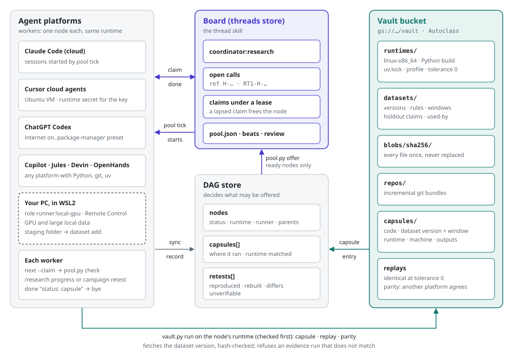

<!--
SPDX-FileCopyrightText: 2026 Dermot O'Brien
SPDX-License-Identifier: CC-BY-4.0
-->

# Concepts

The ideas you need to use AI-Assisted Research (AAR), in the order you meet them. The
[quick start](quick-start.md) shows most of them working; the [skills guide](skills.md)
says which skill does what.

## The workspace and research.yaml

AAR works inside a git repository, the workspace. Its root holds `research.yaml`, which
tells every tool where the research lives: the DAG, the node index, the work items and the
dashboard. The `/research start` and `/research init` flows create it from [`research.yaml.example`](../skills/research/assets/research.yaml.example) when there is none, and never overwrite it; no installer writes it. Paths in it are relative to the folder that holds it. Tools find it by
searching upward from the working directory, so you can run them from any subfolder.
[Configuration](configuration.md) lists every key.

## The hypothesis DAG

The research record is a directed acyclic graph of hypotheses, kept as YAML at `dag_path`
(conventionally `research/hypothesis-dag.yaml`). Each node is one hypothesis: a specific,
measurable change, a metric, a target, and the evidence it rests on. A node's `parent` is
the node that must be resolved before it can be tested, not merely the one that came before
it. The root is usually H-000, the state of the art or the current baseline, and every
avenue explored hangs beneath it.

The DAG is the lineage of ideas: read top to bottom, it shows how the thinking evolved and
what each step was measured against. A negative result stays in it, because the next
person needs to know that avenue was tried.

## Node ids

A flat DAG numbers nodes H-000, H-001, H-002. A DAG with hierarchical ids numbers a child
under its parent: H-204.4.26 after H-204.4.25, H-705 as the next in the H-700 block, H-204.1
to start a new level. `dag_update.py` allocates ids in whichever scheme the DAG already
uses. A letter suffix (H-204.4.25b) marks a node renamed because a concurrent writer took
its id first; see [the shared DAG store](#the-shared-dag-store).

## Node status

`status` says whether a hypothesis is true, as far as the research knows.

| Status | Meaning |
|---|---|
| `pending` | Proposed, not yet designed |
| `framed` | Experiment designed and a work item created; not yet running |
| `in_progress` | Running, on its own research branch |
| `partially_tested` | Some evidence, not yet conclusive |
| `contested` | A retest, an audit or a later node disagrees with the recorded result, unresolved |
| `backtested` | Met its target on its backtest; its holdout or forward evidence is still to come |
| `holdout_passed` | Met its target on its sealed holdout, at its one look |
| `forward_testing` | Being tested on data as it arrives, at checkpoints fixed at framing |
| `validated` | Met the decision rule fixed at framing |
| `ineffective` | Tested and missed its target. A result, not a failure |
| `retired` | Held once and no longer does, or withdrawn from use; the record stays |
| `discarded` | Stopped before a result, with the reason recorded |
| `completed` | Resolved and closed; used for roots and legacy nodes |

The usual path is `pending` to `framed` to `in_progress` to `validated` or `ineffective`.
`dag_update.py --action update` sets any of these except `partially_tested` and
`completed`, which older DAGs carry and the tools still read.

How far a result can move a node depends on the data it could have seen, its evidence class:
an `exploratory` run moves it nowhere, a `backtest` to `backtested`, a sealed `holdout` to
`holdout_passed`, and `forward` data, which did not exist when the test was fixed, through
`forward_testing` to `validated` or `retired`. A node that fixed no window is validated by its
result as before. The research-dag skill's
[node schema](../skills/research-dag/references/node-schema.md) has the full rule.

## The node index and readiness

`generate_node_index.py` computes, for every open node, whether it can be worked now, and
writes the result to `node_index_path`:

| List | Holds |
|---|---|
| `ready` | `pending` nodes whose parent is `completed`, `validated` or `ineffective`, and pending roots |
| `active` | nodes at `in_progress`, `partially_tested` or `contested` |
| `framed` | nodes at `framed` |
| `blocked` | `pending` nodes whose parent is unresolved, with `blocked_by` naming every unresolved ancestor |

The research skills pick work from `ready` instead of scanning the DAG. An index older than
seven days, or missing a node, is treated as stale and the skills fall back to the DAG. So
regenerate the index after every change; `/research housekeep` and `/research sync`
do it for you.

## Roles and skills

Each workflow is an [Agent Skill](https://agentskills.io): a folder with a `SKILL.md` that
any skills-compatible agent reads. Each plays a role:

| Role | Skills |
|---|---|
| Discovery, the detective | `/research init` reconstructs lineage in a repository whose research predates AAR |
| Specialist, the strategist | `/research start` baselines the state of the art and designs the DAG; `/research lineage` extends it |
| Worker, the optimiser | `/research progress`, `/research frame`, `/research run`, `/research sync` run a strand |
| Auditor, the validator | `/research audit` checks a result is sound |
| Reconciler, the drift detector | `/research reconcile` checks a result is live |
| Housekeeper, the curator | `/research housekeep` keeps the index and dashboard true |

Every role is a flow of the `research` skill, one of four. `research-dag` is the engine: the
Python every flow uses to change and read the DAG (`/research dag` points to it).
`experiment-vault` keeps each measured run so it can be replayed. Both work without
`research`. `literature-discovery` searches the literature and works on its own, without
the rest of AAR. [AGENTS.md](AGENTS.md) describes the roles in more depth.

## The three phases of a hypothesis, and AAW

Research splits into phases so the experimental design is fixed before the result is known.

1. Design. `/research frame {node}` checks the node is ready, extracts its target and
   evidence, and asks AI-Assisted Work (`/work start`) to create a work item for the
   experiment. The node moves to `framed`.
2. Execution. `/research run {WI} {node}` opens the research branch
   `research/{node}-{topic}`, fixes the parent's performance and the target in the work
   item's `metadata.yaml`, moves the node to `in_progress`, and hands the task loop to
   `/work progress`, recording a finding per activity.
3. Homecoming. `/research sync {node} {WI}` reads the measured result, sets the
   node to `validated`, `ineffective` or `discarded` against the target fixed in step 2,
   links the deliverables and regenerates the index.

With an [experiment vault](#the-experiment-vault) configured, design also fixes what the run
will capture, execution runs every measured experiment through `vault.py run`, and
homecoming records no result whose node does not name the capsule it came from.

AAW owns the work: work items, activities, claiming and locking. AAR owns the research:
the hypothesis, the metric and the finding. That is why the research flows that create or
run work need AAW's `work` skill installed. `/research progress` drives the three phases
without you naming a node.

## Deliverables

A finished hypothesis leaves a write-up in the work item's `deliverables/`, from the
templates in [`research/assets/templates/`](../skills/research/assets/templates/):
a blog post and an arXiv-style draft for a result that held, or a pivot report for one that
did not. `changes_template.md` records the research changes log.

## The experiment vault

A result is only as good as the ability to make it again. The DAG records what a hypothesis
claimed and what it showed; the experiment vault, set as `vault` in `research.yaml`, keeps
what the result was made from, in a Google Cloud Storage bucket or a folder.

- A capsule is one run: the exact code at its commit, the data it read, the Python
  environment (the lock and, optionally, every wheel), the hardware, the command, its seeds,
  the console output, the outputs and the metrics. `vault.py run` runs the experiment and
  records all of it, so nothing is described afterwards from memory.
- Content addressing: every file is stored once, named by the SHA-256 of its bytes, so a
  dataset or a wheel shared by a hundred capsules costs one copy. The capsule's id carries the
  first 12 digits of its manifest's hash, and the node records the full hash in its
  `capsules` list, so the DAG, which is in git, proves which capsule a result rests on.
- Write-once: blobs are uploaded first and the manifest last, and nothing is ever
  overwritten, edited or deleted by an agent. A wrong capsule is superseded by a new one,
  never replaced.
- Exact code, stored once: the capsule tags the commit (`vault/<commit12>`, pushed to
  `origin`) and the vault keeps each repository's history as incremental git bundles, so a
  new commit costs only its changes. Restore rebuilds the repository from the bundles,
  checks out the commit and checks its git tree, so the code is the commit, bit for bit,
  even if the repository is later rewritten or lost. A shallow clone is kept as a
  compressed snapshot instead.

`vault.py replay` restores a capsule into a fresh environment, runs the recorded command
and compares the metrics within the tolerance fixed at capture:

| Verdict | Means |
|---|---|
| `identical` | Every metric within tolerance and every output file byte-identical |
| `reproduced` | Every metric within tolerance; some output files differ |
| `drifted` | A metric moved beyond the tolerance, or is missing |
| `failed` | The command exited non-zero |

Each replay is itself kept as a `retest` capsule on the node. `/research retest` replays a
result after a library, the environment, the code or the data changed: a drift moves a
`validated` or `ineffective` node to `contested`, for a person to decide, and a failure
leaves the status alone, since a run that cannot start says nothing about the claim. The
experiment-vault skill's [replaying](../skills/experiment-vault/references/replaying.md) and
[storage](../skills/experiment-vault/references/storage.md) references go further.

### Datasets, windows and evidence

Data that several tests read, or that grows, such as daily prices, is registered in the vault
once as numbered versions, with its sources and a rule: `append-only` (only new files, or
files extended at their end), `revisable` (changes are revisions, with a reason) or `frozen`
(one version). A capsule records the version it read, not a copy, and a revision lists every
result built on an earlier version, to be retested. Only a person, at a terminal, revises an
append-only dataset.

Windows name the part of a dataset a test may see: a `backtest` span of history, a sealed
`holdout` span that each node looks at once and that a sibling of a node that looked cannot,
and a `forward` window of everything added after a version. Backtesting a trading strategy is
then a hypothesis test like any other: developed on the backtest window, judged once on the
holdout, and tested again on each new version of the data as it arrives. The experiment-vault
skill's [datasets](../skills/experiment-vault/references/datasets.md) reference has the commands.

### Runtimes: the same result on any machine

A runtime pins what an evidence run must match: the machine type (`linux-x86_64`), the exact
Python build, the project's `uv.lock`, and a determinism profile the vault applies itself (one
thread for every numeric library, one CPU code path, fixed seeds, zone and locale). A node fixes
its runtime at framing, and the vault refuses an evidence run of it anywhere that does not match.
So a result made by Claude Code, Cursor, Codex or your PC is the same number, and `vault.py parity`
shows it was replayed identically on another platform before it counts. Every capsule records
where it ran. The experiment-vault skill's [runtimes](../skills/experiment-vault/references/runtimes.md)
reference has the details and the rules for writing experiments that give the same numbers anywhere.

### The hypothesis pool

Many agents, on several platforms, can run hypotheses at once. A coordinator offers every node
whose parents are resolved on the thread skill's board; an agent takes one, runs it on its
runtime and closes it, which releases its children. A held node keeps its whole chain closed to
other agents. A retest campaign uses the same machinery to retest every result from the root
down, each within a time box, recording reproduced, rebuilt, differs or unverifiable; an
unverifiable node never blocks its children. The research skill's [pool](../skills/research/references/pool.md)
reference is what agents follow, and the [playbook](pool-playbook.md) is how to set it up.

## Audit: is it sound?

`/research audit` first replays the node's capsule, where it has one, which shows the
result can be made again from what was recorded but not that the evaluation was sound. Then
it re-runs the benchmark in a clean room: the evaluation scripts under
`performance/benchmarks/` come from `main`, never from the branch under audit, because a
worker optimising against a benchmark can change the benchmark instead of the system.
[`audit_verify.py`](../skills/research/scripts/audit_verify.py) checks the recorded
performance against the parent's, that the deliverables exist, and with `--clean-room`
that the benchmarks match `main`.

## Adoption: is it live?

A validated node can be entirely absent from the running system. So each node carries a
second, independent state, `adoption.state`: `not_assessed`, `not_applicable`,
`not_adopted`, `partial`, `adopted` or `contradicted`. A node claiming `adopted`,
`partial` or `contradicted` owes a verification predicate: a shell command that exits 0
while the claim holds. `/research reconcile` runs every predicate and reports drift without
proposing fixes. [Adoption and drift](adoption-and-drift.md) is the full design.

## Housekeeping and the dashboard

`/research housekeep` regenerates the node index, checks every result node has an intact
capsule when a vault is configured, checks that every hypothesis id mentioned in
code and docs exists in the DAG, and rebuilds `research/dashboard.html`: an interactive
graph of the DAG coloured by status, with experiments, breakthroughs, papers and
cross-node findings when those files exist.

## The shared DAG store

One YAML file has one writer at a time. When several machines or agents change one DAG,
set `dag_store` and `dag_project` in `research.yaml`. The DAG then lives in a separate git
repository as append-only JSON event files, one folder per project, so writers never merge
conflict. `dag_update.py` pulls, writes events, pushes with a retry, and regenerates the YAML
at `dag_path` as a view that every other tool reads unchanged. Concurrent edits to one field:
the later wins and the replaced value is reported. Concurrent adds under one id: the later
takes a letter suffix, recorded as an alias.
[The shared DAG store](../skills/research-dag/references/dag-store.md) has the event format
and the day-to-day commands.

## Where AAR meets AAW, and AAA

An AAW `inquiry`, work where nobody yet knows what to do, is an AAR hypothesis. AAR frames
and tests it, and hands the conclusion back to AAW as delivery work or closes it as a
lesson. A finding that settles an architectural choice can become a decision record in
AI-Assisted Architecture. [The inquiry seam](../skills/research/references/inquiry-seam.md) is the contract.

## Principles and model leeway

Every skill ends with the same clause: the workflow is mandatory, the tools are a reference
implementation. An agent may find a better way to do a step, provided it follows the
process and the [research principles](../skills/research/references/principles.md): metric supremacy, lineage
continuity, one fundamental change per node, and the rest.
